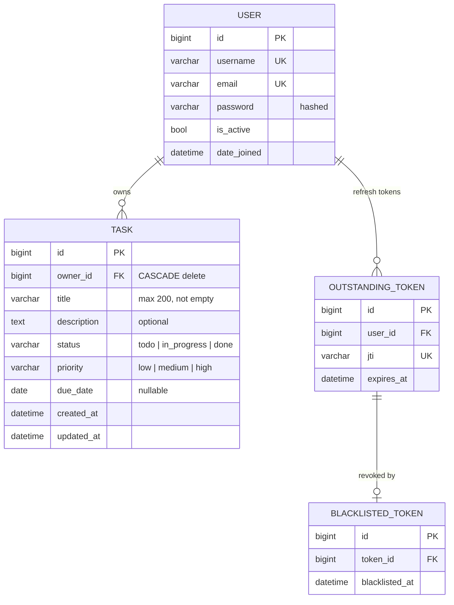
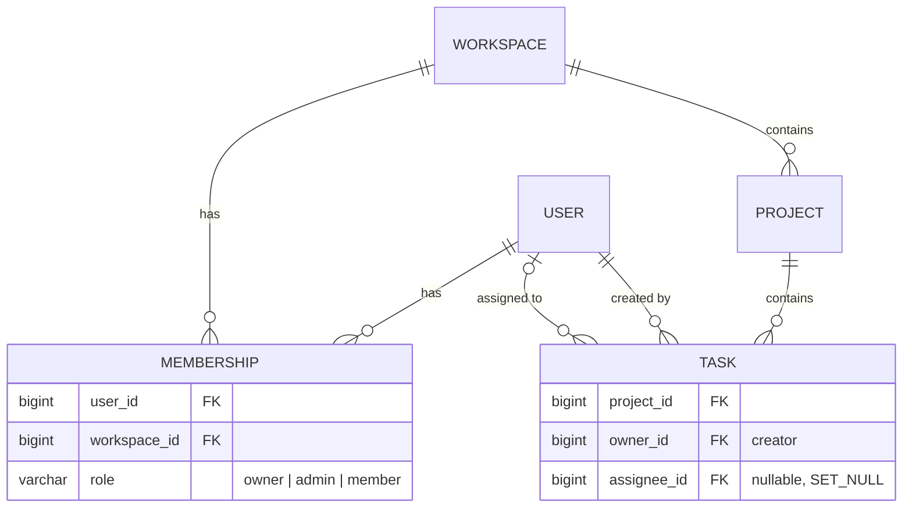

# Data model (ERD)

Source of truth: `backend/accounts/models.py`, `backend/tasks/models.py` and their migrations. Update this file in the same change as any model or migration.

## Current schema

- `accounts.User` extends Django's `AbstractUser`. Standard fields (`first_name`, `last_name`, `is_staff`, groups, permissions) are omitted above. `email` is unique, and registration checks it case-insensitively.
- `tasks.Task`: database CHECK constraints enforce a non-empty title and valid status and priority. Indexes `(owner, status)`, `(owner, due_date)` and `(owner, -created_at)` serve the list filters and default ordering.
- `OUTSTANDING_TOKEN` and `BLACKLISTED_TOKEN` belong to SimpleJWT's `token_blacklist` app. They record issued refresh tokens and the ones revoked on rotation or logout. Prune them with `manage.py flushexpiredtokens`.

## Normalization

The schema is in third normal form (3NF):
- Every non-key column depends only on its table's primary key. There are no repeating groups and no copies of user data on `Task`.
- No derived values are stored. Per-status counts (`tasks/summary/`) and chart data (`tasks/stats/`, 3 queries) are computed with `GROUP BY` at read time.
- `status` and `priority` are fixed vocabularies, so they are CHECK-constrained columns, not lookup tables. They should become tables only if users can define their own values (custom workflows, custom labels).

Policy: keep new tables normalized. Denormalize (counter columns, cached aggregates, copied fields) only for a read that has been measured as slow. When you do, record here which column is derived, what keeps it in sync, and the test that proves it.

## Growing the schema

Likely next features and how to add them without breaking the current rules.

### Teams and shared projects

Today every task belongs to exactly one user, and every query filters on `owner=request.user`. Sharing needs a membership table, not more foreign keys on `Task`:

- The ownership filter becomes a membership filter: `Task.objects.filter(project__workspace__memberships__user=request.user)`. Keep it in one place, the viewset's `get_queryset`, so it cannot be skipped. Another workspace's task still returns 404.
- Migrate in steps: add `project` as nullable, backfill a personal workspace and project per user with a data migration, then make the field required. Do not edit existing migrations.
- Change the indexes to lead with the new filter column, for example `(project, status)`.

### Tags, comments and attachments

- **Tags:** a `Tag` table scoped to a workspace, with `Task.tags` as a many-to-many field. Keep the tag name unique per workspace.
- **Comments:** a `Comment` table with `task` (FK, cascade), `author` (FK) and `body`, indexed on `(task, created_at)`.
- **Attachments:** store files in object storage (S3 or similar) and keep only metadata in Postgres: key, size, content type and uploader.
- **History:** if an audit trail is needed, add an append-only `TaskEvent` table (`task`, `actor`, `type`, JSON `changes`, `created_at`) rather than history columns on `Task`.

### Database growth

The current indexes are enough for a large number of tasks per user. When traffic grows, apply these roughly in order (the full order is in Roadmap phase 6):

1. Check slow queries with `EXPLAIN ANALYZE` before adding an index. Every index slows writes.
2. Use a connection pool (PgBouncer, or Django's built-in Postgres pool) when running several gunicorn workers.
3. Replace `count` in pagination with cursor pagination if counting large result sets gets slow.
4. Add a read replica for list and summary endpoints if reads dominate.
5. Consider partitioning or archiving `done` tasks only at tens of millions of rows. It is not needed before then.

## Roadmap

A step-by-step order for the changes above. Each phase starts only when its trigger is real, ships as its own change (migration, ERD update, types and tests together), and needs approval before the model is touched. The phases are ordered by dependency, not by date. Record a date in "Status" when a phase lands.

| Phase | Change | Trigger | Status |
|---|---|---|---|
| 0 | Baseline: `User` 1-N `Task`, CHECK constraints, owner-leading indexes | — | Done |
| 1 | `Task.completed_at` | Need "completed per week", burndown, or cycle time | Planned |
| 2 | Full-text search | Search feels slow, or users ask for relevance ranking | Planned |
| 3 | Workspaces, projects, membership, assignee | First request to share tasks | Planned |
| 4 | Tags, comments, attachments | Product asks for them (each is independent) | Planned |
| 5 | `TaskEvent` audit log | Need history, "who changed what", or undo | Planned |
| 6 | Scale-out: pooling, caching, replicas, partitioning | Measured load, not before | As needed |

### Phase 1: `completed_at`
- Add `completed_at` (datetime, nullable) and index `(owner, completed_at)`.
- Set it when `status` becomes `done`, and clear it when the task leaves `done`. Do this in the model's `save()` or the serializer, in one place.
- Add a CHECK constraint: `completed_at` is null exactly when `status != 'done'`.
- Data migration: backfill existing done tasks with `updated_at`, and say in the release note that this backfill is approximate.
- Then extend `tasks/stats/` with `completed_per_week`, and add the chart (see `docs/features/dashboard.md`, Open work).
- **Done when:** the constraint holds on existing data, pytest covers setting and clearing it, and `makemigrations --check` is clean.

### Phase 2: Full-text search
- Add a `SearchVectorField` (title weight A, description weight B), kept in sync by a database trigger or `GeneratedField`, with a GIN index.
- Replace `icontains` search with `SearchQuery`. Khmer has no word stemming in Postgres, so keep a `pg_trgm` trigram index as a fallback for Khmer text, and test both languages.
- **Done when:** the existing English and Khmer search tests pass, and `EXPLAIN ANALYZE` shows an index scan.

### Phase 3: Workspaces (the expensive one; plan it before building any sharing)
1. Create `Workspace`, `Membership` and `Project`. Add `Task.project` as nullable, and `Task.assignee` as nullable with SET_NULL.
2. Data migration: one personal workspace, membership (role owner) and default project per existing user. Move every task to its owner's project.
3. Make `Task.project` NOT NULL in a separate migration.
4. Move the access rule into `get_queryset` (membership filter), and keep "another workspace returns 404".
5. Re-key the indexes to lead with `project`, for example `(project, status, -created_at)`.
6. Rewrite summary and stats to scope by workspace. Update the frontend types and the ownership tests for every endpoint.
- **Risk:** this changes the authorization model. Review it like the Auth model in `CLAUDE.md`.
- **Done when:** every existing ownership test passes in its membership form, there are new tests for roles, and no query in the code filters on `owner` alone.

### Phase 4: Tags, comments, attachments
- Use the designs in "Tags, comments and attachments" above. They are independent, so ship them one at a time.
- Tags: a unique constraint on `(workspace, name)`, with prefetching in list views so the query count stays constant.
- Comments: index `(task, created_at)`, and paginate.
- Attachments: metadata only in Postgres. Files go to object storage, accessed through signed URLs.

### Phase 5: `TaskEvent` audit log
- Append-only: no update or delete through the API. Write events in the same transaction as the change.
- Index `(task, created_at)`. Partition by month once it is large (see phase 6).
- It can replace the phase 1 backfill guesswork for future analytics.

### Phase 6: Scale-out (only when measured)
Apply in this order, stopping once the measured problem is fixed:
1. **Measure:** check slow-query logs and run `EXPLAIN ANALYZE`. Keep the constant-query-count tests green.
2. **Connection pool:** PgBouncer, or Django's built-in pool (`DATABASES[...]["OPTIONS"]["pool"]`).
3. **Cursor pagination** for long lists (counting gets slow at large offsets).
4. **Cache** `summary` and `stats` per user (or per workspace) in Redis for a short TTL. Invalidate on task save and delete.
5. **Read replica** for list and dashboard reads, through a Django database router. Writes and read-after-write stay on the primary.
6. **Denormalized counters** (for example per-project status counts), only if caching is not enough. Follow the policy in "Normalization".
7. **Partitioning:** `TaskEvent` by month, and archive old `done` tasks, at tens of millions of rows.
8. **Sharding by workspace:** last resort. It is only possible because phase 3 makes every query workspace-scoped.

## Rules for any schema change

- New migration, never an edit to an applied one. Check with `manage.py makemigrations --check --dry-run`.
- Prefer database constraints (CHECK, UNIQUE, NOT NULL) over serializer-only validation.
- Update `frontend/src/api/types.ts` with the serializer, and this ERD with the model.
- Add a pytest proving users cannot read or change rows outside their own scope.
